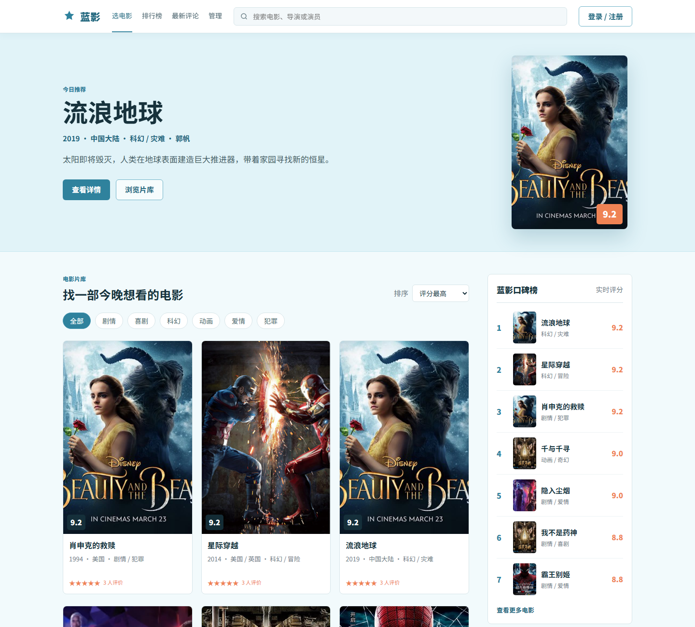
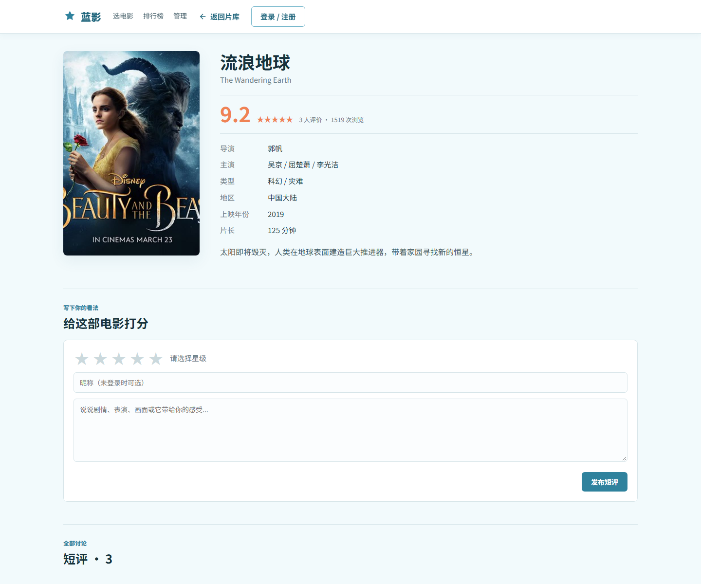
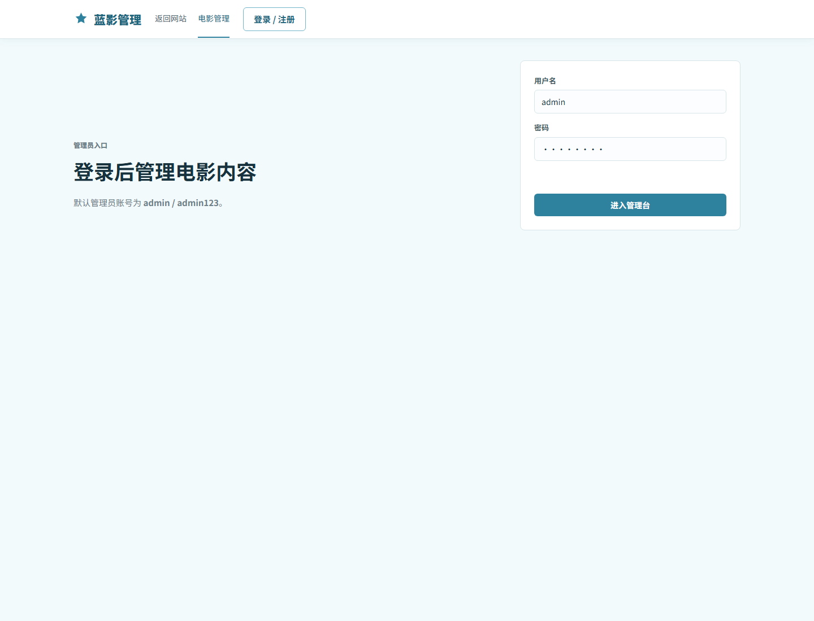
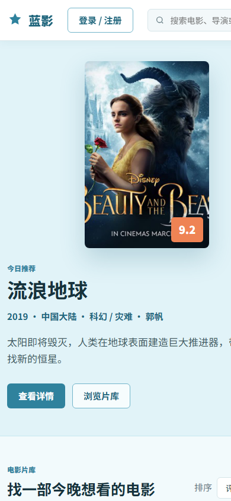

<div align="center">


# 蓝影电影评论网站

一个适合本地运行、课程展示和朋友体验的轻量电影评论平台。  
整体使用浅蓝色信息流设计，提供电影浏览、分类搜索、评分、短评、登录注册和简单后台管理。

[](https://openjdk.org/)
[](https://spring.io/projects/spring-boot)
[](https://www.h2database.com/)
[](#技术栈)
[](https://github.com/nan896/bluefilm-movie-review)

[项目预览](#页面预览) · [快速启动](#本地运行) · [演示账号](#演示账号) · [项目结构](#项目结构) · [GitHub 仓库](#github-仓库)

</div>

> 项目不依赖 MySQL，也不需要单独安装 Node.js。Spring Boot 首次启动时会自动创建 H2 数据库并写入演示电影、评论和账号。

## 项目亮点

| 能力 | 说明 |
| --- | --- |
| 零数据库配置 | 使用 H2 文件数据库，下载代码后即可启动 |
| 完整电影流程 | 浏览、分类、搜索、排行、详情、评分和短评 |
| 用户系统 | 支持注册、登录、退出和评论身份展示 |
| 管理后台 | 支持电影新增、修改、删除和数据统计 |
| 响应式界面 | 桌面端与移动端均可正常使用 |
| GitHub 友好 | 自带 README 截图、`.gitignore` 和启动脚本 |

## 页面预览

### 首页



### 电影详情与评论



### 后台管理



### 移动端



## 功能

- 电影列表、热门推荐、口碑排行和最新短评
- 按关键词、电影类型和评分/浏览量/年份筛选
- 电影详情、评分、浏览量和短评
- 用户注册、登录和退出
- 管理员登录
- 后台电影新增、编辑和删除
- 首次启动自动建库和填充演示数据
- 桌面端和移动端响应式布局

## 技术栈

- Java 17
- Spring Boot 3.3.5
- Spring Web
- Spring Data JPA
- H2 文件数据库
- 原生 HTML、CSS、JavaScript

## 本地运行

### 环境要求

请先安装：

1. JDK 17 或更高版本
2. Maven 3.8 或更高版本

检查环境：

```bash
java -version
mvn -version
```

### 方式一：命令启动

进入项目根目录，执行：

```bash
mvn spring-boot:run
```

第一次运行需要下载 Maven 依赖，时间会稍长。看到类似下面的日志就表示启动成功：

```text
Tomcat started on port 8080 (http)
Started MovieHubApplication
```

浏览器访问：

- 网站首页：http://localhost:8080
- 后台管理：http://localhost:8080/admin.html
- H2 数据库控制台：http://localhost:8080/h2-console

### 方式二：Windows 双击启动

直接双击项目根目录的 `start.bat`。

脚本会自动进入项目目录并执行 `mvn spring-boot:run`。

### 方式三：构建 JAR 后启动

```bash
mvn clean package
java -jar target/movie-review-site.jar
```

Windows 也可以双击 `build.bat` 完成打包。

如果默认的 `8080` 端口已经被占用，可以改用其他端口：

```bash
java -jar target/movie-review-site.jar --server.port=8081
```

然后访问 `http://localhost:8081`。

## 演示账号

| 类型 | 用户名 | 密码 |
| --- | --- | --- |
| 管理员 | `admin` | `admin123` |
| 普通用户 | `demo` | `demo123` |

管理员登录后可以进入 `/admin.html` 添加、修改和删除电影。

## 数据保存与重置

数据默认保存在项目根目录的 `data/` 文件夹内：

```text
data/moviehub.mv.db
```

停止项目后删除整个 `data/` 文件夹，再重新启动，就会重新创建数据库并写入初始演示数据。请只在确认不需要旧数据时执行。

H2 控制台连接信息：

```text
JDBC URL: jdbc:h2:file:./data/moviehub
User Name: sa
Password: 留空
```

## 常用接口

| 方法 | 地址 | 说明 |
| --- | --- | --- |
| GET | `/api/movies` | 电影列表和筛选 |
| GET | `/api/movies/featured` | 首页推荐电影 |
| GET | `/api/movies/rankings` | 电影排行 |
| GET | `/api/movies/{id}` | 电影详情 |
| GET | `/api/movies/{id}/reviews` | 电影短评 |
| POST | `/api/movies/{id}/reviews` | 发布短评 |
| POST | `/api/auth/login` | 登录 |
| POST | `/api/auth/register` | 注册 |
| GET | `/api/auth/me` | 当前登录用户 |
| `/api/admin/**` | 管理接口 | 需要管理员 Token |

## 项目结构

```text
0927movie/
├─ src/main/java/com/bluefilm/moviehub/
│  ├─ model/                 数据实体
│  ├─ repository/            数据访问层
│  ├─ service/               业务逻辑
│  └─ web/                   REST 接口
├─ src/main/resources/
│  ├─ static/                页面、样式、脚本和图片
│  └─ application.yml        项目配置
├─ docs/screenshots/         README 页面截图
├─ start.bat                 Windows 快速启动
├─ build.bat                 Windows 快速打包
└─ pom.xml                   Maven 配置
```

## GitHub 仓库

项目仓库：

https://github.com/nan896/bluefilm-movie-review

从 GitHub 克隆：

```bash
git clone https://github.com/nan896/bluefilm-movie-review.git
cd bluefilm-movie-review
mvn spring-boot:run
```

以后更新代码：

```bash
git add .
git commit -m "update movie review site"
git push
```

项目已经包含 `.gitignore`，`target/`、`data/`、浏览器临时配置和 IDE 文件不会被提交。

## 说明

这是一个适合个人使用、课程演示和发送给朋友体验的轻量项目。当前登录密码以演示为目的直接存储，登录 Token 保存在后端内存中，不适合直接作为公开生产系统使用。

如果要放到公网，建议至少补充：

- 密码加密存储
- 正式用户权限和接口鉴权
- 图片上传而不是手填图片地址
- 数据库备份
- HTTPS 和反向代理
